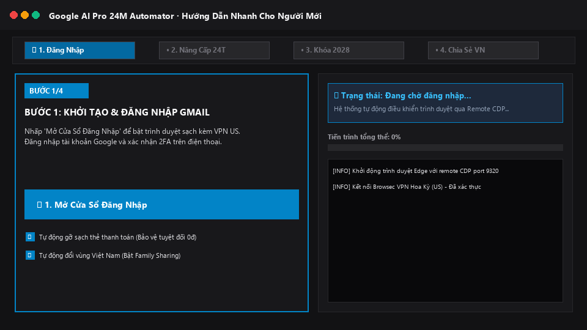
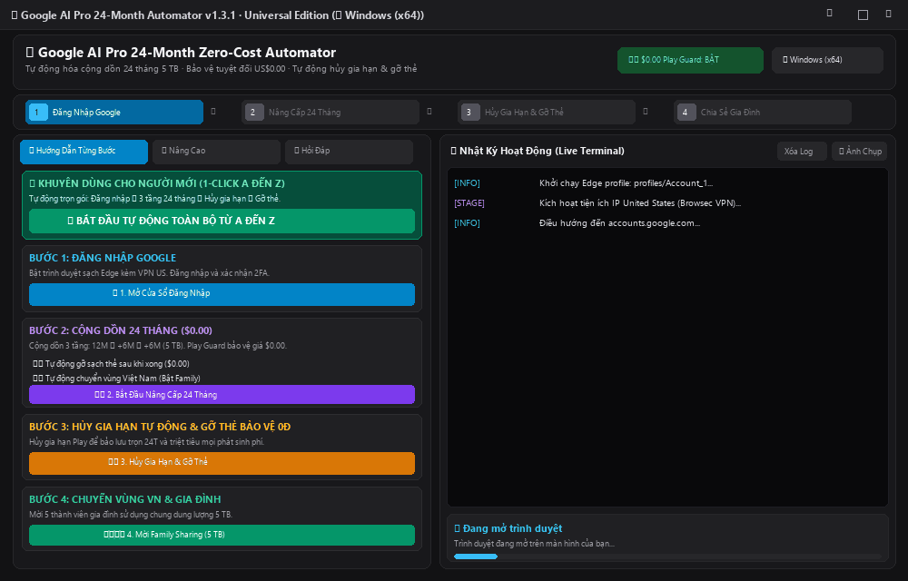
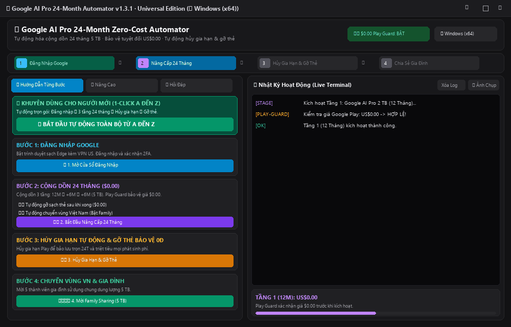

# 🚀 Google AI Pro 24-Month Zero-Cost Stacking Automator

[](https://github.com/tumo07/Google-AI-Pro-24M-ZeroCost-Auto/releases/tag/v1.3.0)
[](setup_macos.sh)
[](https://opensource.org/licenses/MIT)
[](https://www.python.org/)
[](https://playwright.dev/)
[](https://github.com/tumo07)
[](tools/verify_release.py)
[](CHANGELOG.md)

**Google AI Pro 24M Zero-Cost Auto** là bộ công cụ mã nguồn mở tự động hóa quy trình nghiên cứu cấu trúc gói đăng ký Google One / Google AI Pro (5 TB) và YouTube Premium 24 tháng với cơ chế bảo vệ nghiêm ngặt **US$0.00 (Zero-Billing Price Guard)** và tự động hủy gia hạn & gỡ sạch thẻ ngân hàng sau khi hoàn tất.

---

## 📥 Tải Về Nhanh (Fast Direct Downloads)

Người dùng có thể tải ngay các gói đóng gói sẵn từ [Trang GitHub Releases chính thức](https://github.com/tumo07/Google-AI-Pro-24M-ZeroCost-Auto/releases) mà không cần cài đặt dòng lệnh:

| Bản Phát Hành (Package) | Hệ Điều Hành | Chi Tiết Gói | Liên Kết Tải Nhanh (Direct Download) |
| :--- | :--- | :--- | :--- |
| **🪟 Windows Standalone (.exe)** | Windows 10/11 (64-bit) | Bản EXE độc lập đóng gói sẵn, **không cần cài Python**. Khắc phục triệt để lỗi phân quyền PowerShell / Windows Terminal (`0x80070005`). | [⬇️ **Tải GoogleAIProAutomator-v1.3.0-Windows-x64-Standalone.zip** (~81 MB)](https://github.com/tumo07/Google-AI-Pro-24M-ZeroCost-Auto/releases/download/v1.3.0/GoogleAIProAutomator-v1.3.0-Windows-x64-Standalone.zip) |
| **🍎 macOS Standalone DMG (Apple Silicon)** | macOS 12+ (M1 / M2 / M3 / M4 arm64) | Bộ cài đặt đĩa ảnh `.dmg` độc lập hoàn chỉnh cho Apple Silicon. Kéo thả vào Applications chạy ngay, **không cần cài Python hay cấu hình**. | [⬇️ **Tải GoogleAIProAutomator-v1.3.0-macOS-AppleSilicon.dmg** (~185 MB)](https://github.com/tumo07/Google-AI-Pro-24M-ZeroCost-Auto/releases/download/v1.3.0/GoogleAIProAutomator-v1.3.0-macOS-AppleSilicon.dmg) |
| **🍎 macOS Universal DMG (Mọi dòng Mac)** | macOS 12+ (Apple Silicon & Intel) | Bộ cài đặt đĩa ảnh `.dmg` phổ quát chứa `Google AI Pro Automator.app` tương thích 100% với cả chip M-series và Intel. | [⬇️ **Tải GoogleAIProAutomator-v1.3.0-macOS-Universal.dmg** (~18 MB)](https://github.com/tumo07/Google-AI-Pro-24M-ZeroCost-Auto/releases/download/v1.3.0/GoogleAIProAutomator-v1.3.0-macOS-Universal.dmg) |
| **🍎 macOS Standalone DMG (Intel)** | macOS 12+ (Intel x86_64) | Bộ cài đặt đĩa ảnh `.dmg` tối ưu cho máy Mac sử dụng chip Intel. | [⬇️ **Tải GoogleAIProAutomator-v1.3.0-macOS-Intel.dmg** (~18 MB)](https://github.com/tumo07/Google-AI-Pro-24M-ZeroCost-Auto/releases/download/v1.3.0/GoogleAIProAutomator-v1.3.0-macOS-Intel.dmg) |
| **🍎 macOS Universal Bundle (.zip)** | macOS (Apple Silicon & Intel) | Gói nén chứa file `Google AI Pro Automator.app` + `Google_AI_Pro_Automator.command` đã cấp sẵn quyền POSIX 0755. | [⬇️ **Tải Google-AI-Pro-Automator-v1.3.0-macOS-Universal.zip** (~15 MB)](https://github.com/tumo07/Google-AI-Pro-24M-ZeroCost-Auto/releases/download/v1.3.0/Google-AI-Pro-Automator-v1.3.0-macOS-Universal.zip) |
| **🪟 Windows Portable (Python)** | Windows 10/11 (64-bit) | Bản Portable gọn nhẹ kèm bộ tự động nạp thư viện `ensure_env.py` (yêu cầu máy có Python 3.10+). | [⬇️ **Tải Google-AI-Pro-Automator-v1.3.0-Windows-Portable.zip** (~15 MB)](https://github.com/tumo07/Google-AI-Pro-24M-ZeroCost-Auto/releases/download/v1.3.0/Google-AI-Pro-Automator-v1.3.0-Windows-Portable.zip) |

> 💡 **Khuyến nghị cho người mới:**
> - Trên **Windows**: Tải bản **[Windows Standalone (.exe)](https://github.com/tumo07/Google-AI-Pro-24M-ZeroCost-Auto/releases/download/v1.3.0/GoogleAIProAutomator-v1.3.0-Windows-x64-Standalone.zip)** để nhấp đúp chạy ngay.
> - Trên **macOS**: Tải bản **[macOS Standalone DMG (Apple Silicon)](https://github.com/tumo07/Google-AI-Pro-24M-ZeroCost-Auto/releases/download/v1.3.0/GoogleAIProAutomator-v1.3.0-macOS-AppleSilicon.dmg)** hoặc bản Universal. Chỉ cần mở đĩa ảo và kéo vào `Applications`.  
> 📌 **Truy cập Release Page:** [Xem danh sách toàn bộ các phiên bản phát hành và Changelog](https://github.com/tumo07/Google-AI-Pro-24M-ZeroCost-Auto/releases)

---

## 🎬 Video Clip Hướng Dẫn Nhanh (Visual Walkthrough)

Toàn bộ quy trình 4 bước được thiết kế lại theo dạng **Wizard Từng Bước** trực quan, giúp người mới dễ dàng thao tác mà không cần kiến thức lập trình:



---

## 📖 Hướng Dẫn Sử Dụng Chi Tiết Từng Bước (Cho Người Mới Bắt Đầu)

### 📌 Phần 1: Những thứ cần chuẩn bị trước (Chỉ mất 1 phút)
1. **Một tài khoản Google (Gmail):** Tài khoản cá nhân của bạn cần nâng cấp dung lượng lên 5 TB và AI Pro.
2. **Một thẻ thanh toán quốc tế (Visa hoặc Mastercard):** 
   - Thẻ cứng hoặc thẻ phi vật lý (thẻ ảo) của bất kỳ ngân hàng nào tại Việt Nam (VCB, Techcombank, MB, ACB, Cake, Timo, ViettelPay...).
   - Thẻ đã mở tính năng thanh toán quốc tế và có số dư tối thiểu ~25.000đ (để Google tạm giữ xác thực $0.00 rồi hoàn trả lại ngay lập tức).

---

### 📌 Phần 2: Khởi chạy ứng dụng
- **Trên Windows:** Sau khi tải file `.zip` Standalone, giải nén và nhấp đúp file **`GoogleAIProAutomator.exe`** (hoặc `start_gui.bat`).
- **Trên macOS:** Mở file `.dmg`, kéo ứng dụng **`Google AI Pro Automator.app`** vào thư mục `Applications` và nhấp đúp để mở.

---

### 📌 Phần 3: Quy trình 4 bước trên giao diện mới

#### 🚀 Cách nhanh nhất (1-Click A đến Z):
Trên màn hình ứng dụng, bấm nút to màu xanh lá:  
👉 **`🚀 BẮT ĐẦU TỰ ĐỘNG TOÀN BỘ TỪ A ĐẾN Z`**  
Hệ thống sẽ tự động thực hiện tuần tự toàn bộ các bước bên dưới và kiên nhẫn chờ bạn ở các điểm cần xác thực.

---

#### 🔹 Bước 1: Khởi tạo & Đăng nhập Google


1. Nhấp nút **`🌐 1. Mở Cửa Sổ Đăng Nhập`**.
2. Một cửa sổ trình duyệt Edge riêng biệt sẽ hiện lên (đã được cấu hình sẵn VPN US và tiện ích mở rộng).
3. Bạn tiến hành đăng nhập tài khoản Google của mình và xác thực 2 bước (2FA / Passkey) trên điện thoại nếu có.
4. **Cảm biến thông minh:** Khi bạn xác thực xong, hệ thống sẽ tự động nhận diện và chuyển sang Bước 2 mà bạn không cần nhấn thêm bất kỳ nút nào!

---

#### 🔹 Bước 2: Tự động cộng dồn 24 tháng 5 TB ($0.00)


1. Nhấp nút **`▶️ 2. Bắt Đầu Nâng Cấp 24 Tháng`**.
2. Công cụ tự động chạy tuần tự 3 tầng ưu đãi:
   - **Tầng 1 (12 tháng):** Khởi tạo gói cơ bản Google AI Pro 2 TB + YouTube Premium Add-on.
   - **Tầng 2 (6 tháng):** Cộng dồn ưu đãi OEM Samsung kéo dài thời hạn đến tháng 05/2028.
   - **Tầng 3 (6 tháng):** Nâng cấp lên gói 5 TB, khóa mốc đủ 24 tháng đến tháng 11/2028.
3. **Cơ chế Play Guard:** Màn hình thanh toán sẽ hiển thị thanh màu xanh lá xác nhận số tiền thanh toán là **US$0.00 / Miễn phí 100%**. Nếu có bất kỳ số tiền nào khác $0.00, tool sẽ lập tức dừng để bảo vệ tài khoản của bạn.

---

#### 🔹 Bước 3: Khóa hạn 2028 & Gỡ thẻ bảo vệ tài khoản 0 đồng
1. Sau khi cộng dồn đủ 24 tháng, hệ thống tự động chuyển sang trang quản lý gói đăng ký Google Play.
2. Công cụ tự động bấm **Hủy gia hạn định kỳ (Cancel Auto-Renewal)**: Thao tác này giúp bạn bảo lưu trọn vẹn 24 tháng quyền lợi đến tháng 11/2028 mà triệt tiêu hoàn toàn nguy cơ bị tính phí YouTube Premium $11.99 hàng tháng.
3. Tự động chuyển tiếp sang Google Payments và **gỡ bỏ toàn bộ thẻ thanh toán** khỏi ví Google, đảm bảo an tâm 100% không phát sinh bất kỳ khoản phí ngoài ý muốn nào.

---

#### 🔹 Bước 4: Chia sẻ dung lượng 5 TB cho gia đình tại Việt Nam (Tùy chọn)
1. Nhấp nút **`🇻🇳 4. Chuyển Vùng Về Việt Nam`**.
2. Hồ sơ thanh toán của tài khoản sẽ được chuyển vùng về Việt Nam.
3. Bạn truy cập [Google One Family](https://one.google.com/family) để mời tối đa 5 người thân trong gia đình cùng dùng chung kho dung lượng 5 TB.

---

## 💡 Câu Hỏi Thường Gặp (FAQ) & Giải Đáp Thắc Mắc

### ❓ 1. Thẻ ngân hàng của tôi có bị trừ tiền định kỳ không?
> **Trả lời: TUYỆT ĐỐI KHÔNG.**  
> - Trong suốt quá trình thực hiện, tiện ích `Play Guard` chỉ xác nhận khi số tiền hiển thị là **$0.00**.
> - Ngay sau khi nâng cấp xong, hệ thống hủy gia hạn định kỳ và gỡ sạch thẻ ra khỏi tài khoản Google Payments. Tài khoản của bạn sẽ không còn lưu bất kỳ thông tin thanh toán nào.

### ❓ 2. Tôi nên sử dụng loại thẻ nào để xác thực?
> **Trả lời:** Bất kỳ thẻ Visa hoặc Mastercard nào có mở chiều thanh toán trực tuyến quốc tế. Bạn có thể dùng thẻ ảo (Cake, Timo, ViettelPay, MB...) hoặc thẻ vật lý (VCB, Techcombank, ACB...).

### ❓ 3. Khi gặp xác thực 2 bước (2FA) hoặc Captcha thì làm gì?
> **Trả lời:** Hệ thống có cảm biến tự dừng khi gặp màn hình nhập mã số điện thoại, Passkey hoặc Captcha. Bạn cứ bình tĩnh thao tác trên điện thoại hoặc giải Captcha, sau khi hoàn tất hệ thống sẽ **tự động chạy tiếp**.

### ❓ 4. Làm sao để nâng cấp nhiều tài khoản?
> **Trả lời:** Trong ứng dụng, chuyển sang tab **⚙️ Nâng Cao**, chọn **➕ Thêm Phiên Tài Khoản Mới (Account_2, Account_3...)**. Mỗi tài khoản sẽ chạy trên một không gian trình duyệt độc lập, không bị lẫn lộn dữ liệu.

---

## 🔒 Xác Minh Chữ Ký Số Bản Phát Hành (Release Verification)

Để đảm bảo bạn đang sử dụng phiên bản chính chủ từ tác giả **Trinh Dang Khoa (@tumo07)** và không bị chèn mã độc bởi các bên reup trái phép, hãy chạy lệnh xác minh:

```powershell
python tools/verify_release.py
```

Kết quả hợp lệ sẽ hiển thị:
```text
======================================================================
  Google AI Pro 24M Zero-Cost Auto — Authenticity Verification
  Author: Trinh Dang Khoa (Alex Trinh) <tumo07@io.vn> | GitHub: @tumo07
======================================================================
[+] [1/2] DIGITAL SIGNATURE VERIFIED: Authentic cryptographic signature from author (@tumo07).
[+] [2/2] INTEGRITY VERIFIED: All repository files match official SHA-256 hashes.

>>> VERIFICATION PASSED: Genuine, Untampered Open-Source Release. <<<
```

---

## 🛡️ Cam Kết Bảo Mật (Security & Privacy)

- **Không lưu trữ bí mật:** Mã nguồn không chứa bất kỳ máy chủ thu thập dữ liệu (no telemetry, no analytics, no external C2).
- **Mã nguồn mở 100%:** Toàn bộ logic script và extension ở dạng văn bản rõ (plain JavaScript/Python), bất kỳ ai cũng có thể đọc và audit trước khi sử dụng.
- **Tránh rò rỉ thông tin cá nhân:** File `config.local.json`, cache trình duyệt và hồ sơ phiên đăng nhập đều được loại trừ trong `.gitignore`.

---

## 📜 Giấy Phép (License)

Dự án được phân phối dưới giấy phép [MIT License](LICENSE).
<!-- ​‌​​​​​‌​‌​‌​‌​‌​‌​‌​‌​​​‌​​‌​​​​‌​​‌‌‌‌​‌​‌​​‌​​‌​‌‌‌‌‌​‌​‌​‌‌‌​‌​​​​​‌​‌​‌​‌​​​‌​​​‌​‌​‌​‌​​‌​​‌​​‌‌​‌​‌​​​​​‌​‌​‌​​‌​​‌​​‌​‌‌​​‌‌‌​‌​​​‌​​​​​​‌​​​​‌‌​‌‌​‌‌‌‌​‌‌‌​​​​​‌‌‌‌​​‌​‌‌‌​​‌​​‌‌​‌​​‌​‌‌​​‌‌‌​‌‌​‌​​​​‌‌‌​‌​​​​‌​​​​​​​‌​‌​​​​‌‌​​​‌‌​​‌​‌​​‌​​‌​​​​​​​‌‌​​‌​​​‌‌​​​​​​‌‌​​‌​​​‌‌​‌‌​​​‌​​​​​​‌​‌​‌​​​‌‌‌​​‌​​‌‌​‌​​‌​‌‌​‌‌‌​​‌‌​‌​​​​​‌​​​​​​‌​​​‌​​​‌‌​​​​‌​‌‌​‌‌‌​​‌‌​​‌‌‌​​‌​​​​​​‌​​‌​‌‌​‌‌​‌​​​​‌‌​‌‌‌‌​‌‌​​​​‌​​‌​​​​​​​‌​‌​​​​‌​​​​​‌​‌‌​‌‌​​​‌‌​​‌​‌​‌‌‌‌​​​​​‌​​​​​​‌​‌​‌​​​‌‌‌​​‌​​‌‌​‌​​‌​‌‌​‌‌‌​​‌‌​‌​​​​​‌​‌​​‌​​‌​​​​​​​‌‌‌‌​​​‌‌‌​‌​​​‌‌‌​‌​‌​‌‌​‌‌​‌​‌‌​‌‌‌‌​​‌‌​​​​​​‌‌​‌‌‌​‌​​​​​​​‌‌​‌​​‌​‌‌​‌‌‌‌​​‌​‌‌‌​​‌‌‌​‌‌​​‌‌​‌‌‌​​​‌‌‌‌‌​​​‌​​​​​​​‌​‌‌​‌​​‌​​​​​​‌​​​‌‌‌​‌‌​‌​​‌​‌‌‌​‌​​​‌​​‌​​​​‌‌‌​‌​‌​‌‌​​​‌​​​‌‌‌​‌​​​‌​​​​​​‌​​​​​​​‌‌‌​‌​​​‌‌‌​‌​‌​‌‌​‌‌​‌​‌‌​‌‌‌‌​​‌‌​​​​​​‌‌​‌‌‌​​‌​​​​​​​‌​‌‌​‌​​‌​​​​​​‌​​​‌​‌​‌‌​​‌​​​​‌‌​​‌​​​‌‌​‌​‌​​‌‌​‌​‌​​‌‌​​​‌​​‌‌‌​​‌​​‌‌‌​‌​​​‌​​​​​​‌​​‌‌​‌​‌‌​‌‌​‌​‌​​​‌​​​​‌‌‌​​‌​‌‌‌‌​‌​​​‌​‌​‌‌​‌​​‌‌​‌​​‌​‌‌‌‌​​‌‌​​‌​​‌​​​​‌‌​‌‌​​‌‌‌​‌​‌​‌‌​​​‌​‌​‌‌​‌​​‌​‌​​‌‌​‌​​​​‌‌‌‌​​​​‌​​​​‌‌​‌​​‌‌‌​​​‌‌​​‌‌​‌‌​‌​‌‌​‌‌‌​​‌‌​‌‌​​‌​‌​‌​​‌​​​​​‌‌​‌‌​​‌‌‌​‌‌​​‌​​‌​​‌​‌‌​‌‌‌​​‌​‌‌​​‌​‌​​‌‌​​​‌​‌​‌‌‌​‌‌​​‌​‌​​‌‌‌​​‌​‌‌‌​‌‌‌​‌​‌​​‌‌​‌​​‌‌‌​​‌‌‌​‌‌‌​‌‌​‌‌​‌​‌‌​​‌​‌​​‌‌​​​​​‌​​‌​​​​‌‌‌‌​​‌​‌‌​​​​‌​‌‌‌​‌‌‌‍ -->
Bản quyền thuộc về **© 2026 Trinh Dang Khoa (Alex Trinh) <tumo07@io.vn>**.

---

## ⚠️ Tuyên Bố Miễn Trừ Trách Nhiệm (Disclaimer)

Dự án này được tạo ra cho mục đích nghiên cứu học thuật về giao thức phân phối ưu đãi OEM và thử nghiệm tự động hóa giao diện trình duyệt. Tác giả không chịu trách nhiệm đối với bất kỳ việc sử dụng sai mục đích nào vi phạm Điều khoản dịch vụ của bên thứ ba.
