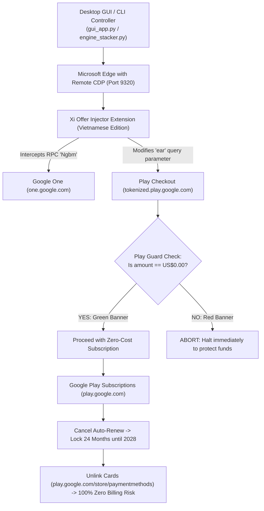

# 🚀 Google AI Pro 24-Month Zero-Cost Stacking Automator

[](https://github.com/tumo07/Google-AI-Pro-24M-ZeroCost-Auto/releases/tag/v1.2.0)
[](setup_macos.sh)
[](https://opensource.org/licenses/MIT)
[](https://www.python.org/)
[](https://playwright.dev/)
[](https://github.com/tumo07)
[](tools/verify_release.py)
[](CHANGELOG.md)

**Google AI Pro 24M Zero-Cost Auto** là bộ công cụ mã nguồn mở tự động hóa quy trình nghiên cứu cấu trúc gói đăng ký Google One / Google AI Pro (5 TB) và YouTube Premium 24 tháng với cơ chế bảo vệ nghiêm ngặt **US$0.00 (Zero-Billing Price Guard)**.

---

## 📥 Tải Về Nhanh (Fast Direct Downloads)

Người dùng có thể tải ngay các gói phần mềm đóng gói sẵn từ [Trang GitHub Releases chính thức](https://github.com/tumo07/Google-AI-Pro-24M-ZeroCost-Auto/releases) mà không cần cài đặt dòng lệnh phức tạp:

| Bản Phát Hành (Package) | Hệ Điều Hành | Chi Tiết Gói | Liên Kết Tải Nhanh (Direct Download) |
| :--- | :--- | :--- | :--- |
| **🪟 Windows Standalone (.exe)** | Windows 10/11 (64-bit) | Bản EXE độc lập đóng gói sẵn, **không cần cài Python**. Khắc phục triệt để lỗi phân quyền PowerShell / Windows Terminal (`0x80070005`). | [⬇️ **Tải GoogleAIProAutomator-v1.2.0-Windows-x64-Standalone.zip** (~81 MB)](https://github.com/tumo07/Google-AI-Pro-24M-ZeroCost-Auto/releases/download/v1.2.0/GoogleAIProAutomator-v1.2.0-Windows-x64-Standalone.zip) |
| **🪟 Windows Portable (Python)** | Windows 10/11 (64-bit) | Bản Portable gọn nhẹ (chứa mã nguồn + file chạy `.bat`), yêu cầu máy tính đã cài đặt Python 3.10+. | [⬇️ **Tải Google-AI-Pro-Automator-v1.2.0-Windows-Portable.zip** (~15 MB)](https://github.com/tumo07/Google-AI-Pro-24M-ZeroCost-Auto/releases/download/v1.2.0/Google-AI-Pro-Automator-v1.2.0-Windows-Portable.zip) |
| **🍎 macOS Universal (.command)** | macOS 12+ (Apple Silicon M1-M4 & Intel) | Chạy 1-click trực tiếp trên Mac qua file `Google_AI_Pro_Automator.command` trong Finder. Tự động kiểm tra Python & cài đặt môi trường. | [⬇️ **Tải Google-AI-Pro-Automator-v1.2.0-macOS-Universal.zip** (~15 MB)](https://github.com/tumo07/Google-AI-Pro-24M-ZeroCost-Auto/releases/download/v1.2.0/Google-AI-Pro-Automator-v1.2.0-macOS-Universal.zip) |

> 💡 **Khuyến nghị:** Nếu bạn chỉ muốn chạy công cụ ngay lập tức trên máy tính Windows mà không muốn cài đặt Python hay cấu hình môi trường, hãy tải bản **[Windows Standalone (.exe)](https://github.com/tumo07/Google-AI-Pro-24M-ZeroCost-Auto/releases/download/v1.2.0/GoogleAIProAutomator-v1.2.0-Windows-x64-Standalone.zip)**.  
> 📌 **Truy cập Release Page:** [Xem danh sách toàn bộ các phiên bản phát hành và Changelog](https://github.com/tumo07/Google-AI-Pro-24M-ZeroCost-Auto/releases)

---

## 🌟 Tính Năng Nổi Bật (Key Features)

- **🍎 Hỗ Trợ Toàn Diện macOS (Apple Silicon M1-M4 & Intel):** Tương thích 100% trên mọi dòng máy Mac (Apple Silicon arm64 và Intel x86_64). Hỗ trợ chạy 1-click qua file `Google_AI_Pro_Automator.command` trong Finder hoặc chạy qua Terminal.
- **🛡️ Tuyệt Đối 0 Đồng (Zero-Billing Guarantee):** Tích hợp bộ kiểm soát giá đa tầng (`play_guard.js` & `automation_engine.py`). Chỉ thực hiện thao tác khi màn hình Google Play Checkout xác nhận hiển thị chính xác **$0.00 / Miễn phí**.
- **🧩 Extension Đã Bản Địa Hóa Tiếng Việt:** Toàn bộ tiện ích mở rộng (`extensions/google_pro_6_12_24`) được dịch và thiết kế lại 100% bằng Tiếng Việt, hiển thị hướng dẫn chi tiết từng bước và trạng thái kích hoạt thời gian thực.
- **🔄 Đa Tầng Cộng Dồn (Multi-Layer Stacking Engine):**
  - **Tầng 1 (12 tháng):** Khởi tạo gói đăng ký Google AI Pro 2 TB + YouTube Premium Add-on.
  - **Tầng 2 (6 tháng):** Cộng dồn ưu đãi OEM Samsung (SS) kéo dài lên 18 tháng.
  - **Tầng 3 (6 tháng):** Nâng cấp gói 5 TB / kết hợp ưu đãi, khóa mốc đủ 24 tháng (hạn sử dụng đến năm 2028).
  - **Bước 5 (Khóa hạn 2028):** Tự động điều hướng sang Google Play để hủy gia hạn định kỳ, triệt tiêu mọi nguy cơ trừ tiền hàng tháng mà vẫn bảo lưu trọn vẹn 24 tháng quyền lợi.
- **💳 Tự Động Gỡ Bỏ Thẻ Thanh Toán (Zero-Billing Absolute Guard):** Sau khi hủy gia hạn và cố định mốc 2028, hệ thống tự động hướng dẫn và thực hiện quy trình gỡ bỏ toàn bộ thẻ Visa/Mastercard khỏi Google Payments để triệt tiêu 100% mọi nguy cơ phát sinh phí định kỳ.
- **🇻🇳 Sẵn Sàng Cho Chia Sẻ Gia Đình (Vietnam Family Sharing Ready):** Tự động hướng dẫn và chuyển vùng hồ sơ để kích hoạt Google One Family Sharing cho các tài khoản thành viên tại Việt Nam.
- **🔐 Chữ Ký Số Mã Hóa Ed25519 (Cryptographically Signed):** Toàn bộ mã nguồn phát hành được bảo vệ và xác thực bằng chữ ký số bất đối xứng Ed25519 của tác giả (@tumo07), chống giả mạo, tráo đổi mã độc hoặc chiếm đoạt bản quyền.

---

## 🏗️ Kiến Trúc Hệ Thống (Architecture)



---

## 📋 Yêu Cầu Hệ Thống (Prerequisites)

1. **Hệ điều hành:** Windows 10 / 11 (64-bit) HOẶC macOS 12+ (Monterey, Ventura, Sonoma, Sequoia trên chip Apple Silicon M1-M4 hoặc Intel).
2. **Trình duyệt:** Microsoft Edge hoặc Google Chrome đã cài đặt mặc định.
3. **Python:** Phiên bản 3.10 trở lên ([python.org](https://www.python.org/downloads/)). Nhớ tích chọn **"Add Python to PATH"** khi cài đặt.
4. **Thẻ thanh toán quốc tế:** Visa hoặc Mastercard hỗ trợ thanh toán quốc tế và mở chiều thanh toán trực tuyến (Thẻ chỉ dùng để xác thực danh tính với Google $0.00 Temporary Hold, hoàn toàn không trừ tiền).

---

## ⚡ Hướng Dẫn Cài Đặt & Sử Dụng (Quick Start)

### 1. Cài đặt thư viện phụ thuộc
Mở PowerShell hoặc Command Prompt tại thư mục dự án và chạy:
```powershell
pip install -r requirements.txt
python -m playwright install chromium
```

### 2. Cấu hình mẫu (`config.json`)
Sao chép file mẫu `config.example.json` thành `config.json` và điền thông tin của bạn:
```powershell
copy config.example.json config.json
```
Nội dung file `config.json`:
```json
{
  "target_region": "US",
  "target_plan": "pro_2year_zero",
  "auto_cancel": true,
  "use_vpn": true,
  "card": {
    "number": "4000000000000000",
    "exp_month": "12",
    "exp_year": "28",
    "cvc": "000",
    "holder": "NGUYEN VAN A",
    "address_line1": "700 SW 5th Ave",
    "postal_code": "97201",
    "locality": "Portland",
    "province": "OR",
    "country": "US"
  },
  "accounts": [
    {
      "id": "Account_1",
      "email": "your_account@gmail.com",
      "status": "pending_login",
      "current_step": 0
    }
  ]
}
```
*(Ghi chú: Mã bưu chính 97201 là vùng miễn thuế bang Oregon, Hoa Kỳ).*

### 3. Khởi chạy ứng dụng

#### 🪟 Dành cho Windows:
- **Lựa chọn 1 (Bản Standalone - Khuyên dùng, không cần Python):** Tải và giải nén file `GoogleAIProAutomator-v1.2.0-Windows-x64-Standalone.zip`, sau đó nhấp đúp chạy trực tiếp **`GoogleAIProAutomator.exe`**.
- **Lựa chọn 2 (Bản Portable / Mã nguồn):** Nhấp đúp vào file **`start_gui.bat`** hoặc **`Google_AI_Pro_Tool.bat`** để mở giao diện điều khiển.
- **Lựa chọn 3 (Dòng lệnh):** Mở terminal và chạy `python gui_app.py`.

> 💡 **Khắc phục lỗi Windows Terminal `0x80070005` (Access Denied):**  
> Nếu Windows Terminal trên máy bạn hiển thị thông báo lỗi `[error 2147942405 (0x80070005) when launching ... powershell.exe]`, điều này do PowerShell bị chặn hoặc thiếu phân quyền hệ thống. Hãy sử dụng **Lựa chọn 1 (Bản Standalone .exe)** hoặc mở ứng dụng qua Command Prompt (`cmd.exe`). Phiên bản v1.2.0+ sử dụng cơ chế socket lock thuần Python nên hoàn toàn độc lập với PowerShell.

#### 🍎 Dành cho macOS (Apple Silicon & Intel):
- **Cách 1 (Nhanh nhất):** Nhấp đúp chuột vào file **`Google_AI_Pro_Automator.command`** trong Finder để tự động cài đặt và mở app.
- **Cách 2 (Terminal):**
  ```bash
  # Chạy cài đặt môi trường tự động
  chmod +x setup_macos.sh && ./setup_macos.sh
  
  # Khởi chạy giao diện trực quan
  ./run_gui.sh
  ```

---

## 🔒 Xác Minh Chữ Ký Số Bản Phát Hành (Release Verification)

Để đảm bảo bạn đang sử dụng phiên bản chính chủ từ tác giả **Trinh Dang Khoa (@tumo07)** và không bị chèn mã độc bởi các bên reup trái phép, hãy chạy lệnh xác minh:

```powershell
python tools/verify_release.py
```

Kết quả hợp lệ sẽ hiển thị:
```text
======================================================================
  Google AI Pro 24M Zero-Cost Auto — Authenticity Verification
  Author: Trinh Dang Khoa (Alex Trinh) <tumo07@io.vn> | GitHub: @tumo07
======================================================================
[+] [1/2] DIGITAL SIGNATURE VERIFIED: Authentic cryptographic signature from author (@tumo07).
[+] [2/2] INTEGRITY VERIFIED: All repository files match official SHA-256 hashes.

>>> VERIFICATION PASSED: Genuine, Untampered Open-Source Release. <<<
```

---

## 🛡️ Cam Kết Bảo Mật (Security & Privacy)

- **Không lưu trữ bí mật:** Mã nguồn không chứa bất kỳ máy chủ thu thập dữ liệu (no telemetry, no analytics, no external C2).
- **Mã nguồn mở 100%:** Toàn bộ logic script và extension ở dạng văn bản rõ (plain JavaScript/Python), bất kỳ ai cũng có thể đọc và audit trước khi sử dụng.
- **Tránh rò rỉ thông tin cá nhân:** File `config.local.json`, cache trình duyệt và hồ sơ phiên đăng nhập đều được loại trừ trong `.gitignore`.

---

## 📜 Giấy Phép (License)

Dự án được phân phối dưới giấy phép [MIT License](LICENSE).
<!-- ​‌​​​​​‌​‌​‌​‌​‌​‌​‌​‌​​​‌​​‌​​​​‌​​‌‌‌‌​‌​‌​​‌​​‌​‌‌‌‌‌​‌​‌​‌‌‌​‌​​​​​‌​‌​‌​‌​​​‌​​​‌​‌​‌​‌​​‌​​‌​​‌‌​‌​‌​​​​​‌​‌​‌​​‌​​‌​​‌​‌‌​​‌‌‌​‌​​​‌​​​​​​‌​​​​‌‌​‌‌​‌‌‌‌​‌‌‌​​​​​‌‌‌‌​​‌​‌‌‌​​‌​​‌‌​‌​​‌​‌‌​​‌‌‌​‌‌​‌​​​​‌‌‌​‌​​​​‌​​​​​​​‌​‌​​​​‌‌​​​‌‌​​‌​‌​​‌​​‌​​​​​​​‌‌​​‌​​​‌‌​​​​​​‌‌​​‌​​​‌‌​‌‌​​​‌​​​​​​‌​‌​‌​​​‌‌‌​​‌​​‌‌​‌​​‌​‌‌​‌‌‌​​‌‌​‌​​​​​‌​​​​​​‌​​​‌​​​‌‌​​​​‌​‌‌​‌‌‌​​‌‌​​‌‌‌​​‌​​​​​​‌​​‌​‌‌​‌‌​‌​​​​‌‌​‌‌‌‌​‌‌​​​​‌​​‌​​​​​​​‌​‌​​​​‌​​​​​‌​‌‌​‌‌​​​‌‌​​‌​‌​‌‌‌‌​​​​​‌​​​​​​‌​‌​‌​​​‌‌‌​​‌​​‌‌​‌​​‌​‌‌​‌‌‌​​‌‌​‌​​​​​‌​‌​​‌​​‌​​​​​​​‌‌‌‌​​​‌‌‌​‌​​​‌‌‌​‌​‌​‌‌​‌‌​‌​‌‌​‌‌‌‌​​‌‌​​​​​​‌‌​‌‌‌​‌​​​​​​​‌‌​‌​​‌​‌‌​‌‌‌‌​​‌​‌‌‌​​‌‌‌​‌‌​​‌‌​‌‌‌​​​‌‌‌‌‌​​​‌​​​​​​​‌​‌‌​‌​​‌​​​​​​‌​​​‌‌‌​‌‌​‌​​‌​‌‌‌​‌​​​‌​​‌​​​​‌‌‌​‌​‌​‌‌​​​‌​​​‌‌‌​‌​​​‌​​​​​​‌​​​​​​​‌‌‌​‌​​​‌‌‌​‌​‌​‌‌​‌‌​‌​‌‌​‌‌‌‌​​‌‌​​​​​​‌‌​‌‌‌​​‌​​​​​​​‌​‌‌​‌​​‌​​​​​​‌​​​‌​‌​‌‌​​‌​​​​‌‌​​‌​​​‌‌​‌​‌​​‌‌​‌​‌​​‌‌​​​‌​​‌‌‌​​‌​​‌‌‌​‌​​​‌​​​​​​‌​​‌‌​‌​‌‌​‌‌​‌​‌​​​‌​​​​‌‌‌​​‌​‌‌‌‌​‌​​​‌​‌​‌‌​‌​​‌‌​‌​​‌​‌‌‌‌​​‌‌​​‌​​‌​​​​‌‌​‌‌​​‌‌‌​‌​‌​‌‌​​​‌​‌​‌‌​‌​​‌​‌​​‌‌​‌​​​​‌‌‌‌​​​​‌​​​​‌‌​‌​​‌‌‌​​​‌‌​​‌‌​‌‌​‌​‌‌​‌‌‌​​‌‌​‌‌​​‌​‌​‌​​‌​​​​​‌‌​‌‌​​‌‌‌​‌‌​​‌​​‌​​‌​‌‌​‌‌‌​​‌​‌‌​​‌​‌​​‌‌​​​‌​‌​‌‌‌​‌‌​​‌​‌​​‌‌‌​​‌​‌‌‌​‌‌‌​‌​‌​​‌‌​‌​​‌‌‌​​‌‌‌​‌‌‌​‌‌​‌‌​‌​‌‌​​‌​‌​​‌‌​​​​​‌​​‌​​​​‌‌‌‌​​‌​‌‌​​​​‌​‌‌‌​‌‌‌‍ -->
Bản quyền thuộc về **© 2026 Trinh Dang Khoa (Alex Trinh) <tumo07@io.vn>**.

---

## ⚠️ Tuyên Bố Miễn Trừ Trách Nhiệm (Disclaimer)

Dự án này được tạo ra cho mục đích nghiên cứu học thuật về giao thức phân phối ưu đãi OEM và thử nghiệm tự động hóa giao diện trình duyệt. Tác giả không chịu trách nhiệm đối với bất kỳ việc sử dụng sai mục đích nào vi phạm Điều khoản dịch vụ của bên thứ ba.
